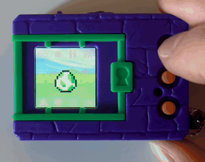
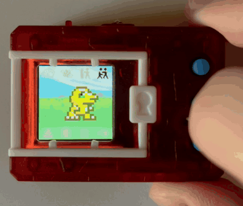

# DMC Definitive

A firmware mod for the Bandai **Digital Monster Color** virtual pet that brings the five versions
together on one device:

- **English text**;
- **all 94 Digimon of Ver.1–5**, each line raised with its own version's rules;
- **egg choice** every time a new egg hatches;
- for every line, the **evolutions, training minigame, backgrounds and jogress** of its original
  version;
- **random battle series**: every area draws its opponents from one of the five versions;
- **link battles** with any Digital Monster Color, original or modded.

This repository contains **no Bandai firmware, code or graphics**: you build the image yourself from
dumps of your own devices (see [Building](#building)).

## Contents

- [Getting started](#getting-started)
- [Choosing an egg](#choosing-an-egg)
- [Caring for your Digimon](#caring-for-your-digimon)
- [Death and the next egg](#death-and-the-next-egg)
- [Evolution](#evolution)
- [Training](#training)
- [Battles](#battles)
- [Link battles and compatibility](#link-battles-and-compatibility)
- [Jogress](#jogress)
- [Backgrounds](#backgrounds)
- [Differences from the original devices](#differences-from-the-original-devices)
- [Building](#building)
- [Legal](#legal)

## Getting started

1. **Back up your device.** Dump its flash before writing anything, so you can always go back.
2. **Build the image** from the five original dumps (see [Building](#building)).
3. **Flash it.** All five versions share the same hardware and flash layout, so the image should run on
   a Ver.1, 2, 3, 4 or 5 device alike. The shell keeps its original look.
4. **Reset the pet on first boot.** A save made by the original firmware uses that version's Digimon
   numbers and would be read as the wrong Digimon.

## Choosing an egg

When a new egg appears (after a reset or after your Digimon dies), the hatching screen lets you pick it:

<p align="center">
  
</p>

| Button | Action |
|---|---|
| **A** | show the next egg: Ver.1 → Ver.2 → Ver.3 → Ver.4 → Ver.5 → Ver.1 … |
| **B** | confirm: the egg hatches and the Digimon belongs to that line for its whole life |

- After a **reset** the choice starts from the Ver.1 egg.
- After a **death** it starts from the egg of the line you just raised.

## Caring for your Digimon

The care rules are the original ones. How fast hunger, strength and waste come depends on the species.

- **Meat**: +1 hunger heart and +1 weight. Eating with a full stomach counts towards **overfeed**: every
  10 extra meals give +1 overfeed.
- **Vitamin (protein)**: +1 strength heart and +2 weight. Every 4 vitamins give +1 DP and also +1
  **overdose** (up to 7), which makes injuries after a lost battle more likely.
- **Calls**: when hunger or strength reach zero the Digimon calls. If nobody answers within **10 minutes**
  it is a **care mistake**. Falling asleep with the light on is also a call: turn the light off within
  **1 hour**.
- **Sleep**: each species has its own bedtime and wake-up time. While it sleeps, hunger, strength and waste
  stop. **8 hours of sleep refill the DP** (battle energy).
- **Disturbed sleep**: feeding, training or battling a sleeping Digimon keeps it awake for 10 minutes and
  restarts the DP recharge. The 15th, 30th and 45th disturbance in a stage injure it.
- **Waste**: clean it up. With **8 piles** the Digimon gets injured.
- **Injuries** (skull icon): heal them with the bandage. Some species need more than one dose. An injury
  left untreated for **6 hours** is fatal.

## Death and the next egg

A Digimon dies when:

- its hunger or its strength stays at zero for **12 hours**;
- an injury is not healed within **6 hours**;
- it gets **15 injuries** in the same stage;
- it has **5 care mistakes** once it is an Adult or higher and can no longer evolve.

A grave appears and a new egg follows: the egg choice starts from the line you just raised. If the
Digimon that died was a Perfect or an Ultimate, there is a 30% chance that the new egg is a
**traited egg**: the next Digimon gets a battle power bonus.

## Evolution

- **Baby I → Baby II** after about 10 minutes; Baby II after 12 hours; Child after 24 hours. Which Digimon it
  becomes depends on care mistakes, training, overfeed and disturbed sleep, with each line's own rules.
- **Adult → Perfect** (after 36 hours) needs at least **15 battles in the current stage**. Then the
  chance depends on the share of wins:

  | Wins | Chance to evolve |
  |---|---|
  | under 40% | none |
  | 40–69% | 25% |
  | 70–79% | 50% |
  | 80% or more | certain |

- **Perfect → Ultimate** (after 48 hours): the same rule, plus at most **1 care mistake**.
- If the check fails, that Digimon **will not evolve any more**.
- At every evolution care mistakes, overfeed, overdose, disturbed sleep, training and the stage's battles
  start again from zero, and the DP are refilled.
- The evolution timer keeps running while the Digimon sleeps.

## Training

The reward is the same for every line: a success gives **+1 strength heart**, and every session counts as
training and costs 1 weight. Every 4 trainings fill an Effort heart. The minigame is the one of the
line's version:

| Line | Minigame |
|---|---|
| Ver.1 | several rounds of attacks: choose high or low with A or B |
| Ver.2 | power bar: press when it is full |
| Ver.3 | press repeatedly to fill the bar in time |
| Ver.4 | rising number: press when it passes 100 |
| Ver.5 | power bar: press when it is full |

## Battles

Single battles are played in 8 areas of up to 5 opponents, unlocked as you win.

- **Every time you enter an area**, the device picks one of the five versions at random, with the same
  chance for each, your own line's version included. The whole series of that area comes from that
  version: its opponents, their power and how many they are.
- The **areas keep their difficulty**: area 1 always holds the first opponents of the chosen version, area
  8 its last ones. Only the version changes, so the stages stay coherent.
- Leaving an area and entering it again draws a new version. Unlocking the next area works as usual.
- Opponents and their power differ between versions: for example the first opponents of Ver.1 and Ver.2
  are stronger than those of Ver.3, 4 and 5.

<p align="center">
  
  <br><em>Entering Stage 1 twice with an Agumon: Palmon (Ver.4) the first time, Betamon (Ver.1) the second.</em>
</p>

How a battle is decided:

- **Power** comes from the species, with a bonus when the strength hearts are full (Child +5, Adult +8,
  Perfect +15, Ultimate +25), counted twice for a Digimon from a traited egg.
- The **chance to hit** is your power divided by the sum of both powers.
- **Attributes** add or remove 5%: Virus beats Data, Data beats Vaccine, Vaccine beats Virus; Free is
  neutral.
- There are 5 attacks: **3 hits win**.
- Each battle costs 1 DP and some weight. A loss can injure the Digimon, more often with overdose.

## Link battles and compatibility

Choose battle → communication, connect the two devices and start the battle from one of them.

- **Compatible** with every Digital Monster Color: original Ver.1–5 and other DMC Definitive devices. Not
  with the older black-and-white Digital Monster.
- The device presents itself as the **version of your Digimon's line**: a Digimon of the Ver.4 line is a
  Ver.4 Digimon for the other device too. An original device of that version shows it correctly.
- You see the **right partner Digimon**, whatever version it comes from.
- An original device of a different version from your line may show your Digimon wrongly: that is how
  the original devices work.
- Link battles with a partner of another version can unlock that version's background.

## Jogress

A jogress happens through a link battle between the two Ultimates (or, for Millenniumon, Kimeramon) of a
pair. Each device evolves its own Digimon into the jogress form of its line.

| Digimon | Partner | Result |
|---|---|---|
| Blitz Greymon (Ver.1) | Cres Garurumon (Ver.2) | Omegamon Alter-S |
| Bancho Leomon (Ver.3) | Darkdramon (Ver.4) | Chaosmon |
| Kimeramon (Ver.3) | Mugendramon (Ver.5) | Millenniumon |
| Darkdramon (Ver.4) | Mugendramon (Ver.5) | Chaosdramon |

The partner can be an original device of that version, or another DMC Definitive raising that line.

## Backgrounds

- The **first egg after a reset** sets the background of its line and unlocks it.
- **Later eggs** unlock their line's background without changing the current one.
- Other backgrounds unlock by playing and linking, as on the original devices.

## Differences from the original devices

- The game runs on the Ver.3 engine: the settings adjust the **screen brightness** (Ver.1 and Ver.2
  originally adjusted the volume instead).
- **Tested on real hardware** so far: start-up, English text, egg choice, hatching, evolutions and the
  sprites of all lines. Training, random battle series, link battles and jogress of the non-Ver.3 lines are
  checked in a simulator against the original code; reports from real devices are welcome.

## Building

Requirements:

- **Python 3.9 or newer** (standard library only);
- **dumps of the five original firmwares**: the full 8 MB SPI flash of unmodified Digital Monster Color
  Ver.1, 2, 3, 4 and 5. The scripts check their SHA-1 (everything before the save area at byte
  `0x7FD000`, which differs on every device) and refuse other dumps; `--skip-dump-check` bypasses the
  check at your own risk;
- **a way to read and write the flash chip** of your device. That part is not covered here.

Build the image, then run the simulator tests on it:

```bash
python3 tools/build_dmc_definitive.py V1.bin V2.bin V3.bin V4.bin V5.bin dmc_definitive.bin
```

```bash
python3 tools/test_dmc_definitive.py dmc_definitive.bin V1.bin V2.bin V3.bin V4.bin V5.bin
```

The image keeps the save area of the Ver.3 dump you pass in.

To change the translation, edit the PNG files in `english/` keeping their size, then rebuild.

| Path | Content |
|---|---|
| `tools/build_dmc_definitive.py` | build script |
| `tools/training.py` | per-line training, random battles, link and jogress |
| `tools/dumps.py` | expected firmware hashes |
| `tools/english.py`, `english/` | translated text sprites |
| `tools/unsp_dis.py`, `unsp_asm.py`, `unsp_sim.py` | μ'nSP disassembler, assembler and simulator |
| `tools/xver.py`, `dmc_sprites.py`, `dmc_stats.py` | cross-version matching, sprite and stats readers |
| `tools/test_dmc_definitive.py` | simulator tests |

## Legal

Digimon and Digital Monster Color are trademarks of Bandai. This is an unofficial fan project, not
affiliated with or endorsed by Bandai, and it contains none of their firmware or graphic files; the
animations in `docs/` are footage of a real device running the mod. Flash at your
own risk. The scripts, this guide and the translated sprites are released under the MIT license (see
[LICENSE](LICENSE)).
